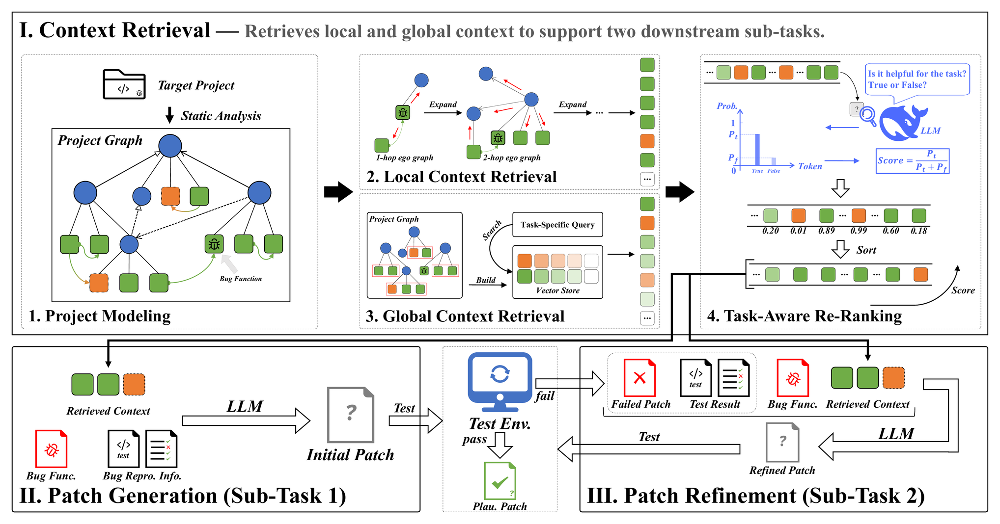

# PSIRepair (Task-Aware Project-Specific Information Selection for LLM-Based Automated Program Repair)

## Overview of PSIRepair



## Preparation

1. Clone Repository
   
   ```shell
   git clone https://github.com/PGZXB/PSIRepair
   ```

2. Set Up Conda Environment
   
   * Create: ```conda create --name psirepair python=3.11.9```
   * Install libraries
     * numpy 1.26.4
     * JPype1 1.5.2
     * chardet 5.2.0
     * openai 1.58.1
     * tenacity 9.0.0
     * javalang 0.13.0
     * langchain 0.3.13
     * langchain-openai 0.2.14
     * tqdm 4.66.4
   * See [psirepair_env.yml](./psirepair_env.yml) for details

3. Prepare JDKs
   
   * Java 7 (for Defects4j V1.2)
   * Java 8 (for Defects4j V2.0)
   * Java 17 (for [Our PG Builder](./PSIRepair/tools/CodeToolkitBackend/src/org/threerepair/CodeToolkitBackend.java))

4. Prepare Benchmarks
   
   * Install [Defects4J V1.2](https://github.com/rjust/defects4j/releases/tag/v1.2.0)
   * Install [Defects4J V2.0](https://github.com/rjust/defects4j/releases/tag/v2.0.0)
   * Install [Vul4J](https://github.com/tuhh-softsec/vul4j)

5. Prepare Configuration Files
   
   * Specify the home directories for Java 7, 8, and 17, as well as Defects4J V1.2 and V2.0, in [basic_config.json](./configs/basic_config.json)
   * Configure the LLM and embedding model settings in [llm_config.json](./configs/llm_config.json) and [embedding_model_config.json](./configs/embedding_model_config.json)

## Perform Repair Experiments

To run PSIRepair, execute [psirepair.sh](./psirepair.sh):

```shell
# In PSIRepair root directory
## Select benchmarks to run (choose 1+ from: d4j-v120, d4j-v200, vul4j)
bash psirepair.sh /path/to/output/ --benchmarks d4j-v120 d4j-v200 vul4j
```

All results will be stored in the output directory you specified.

